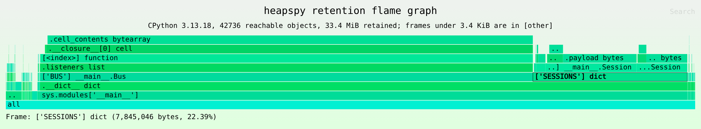
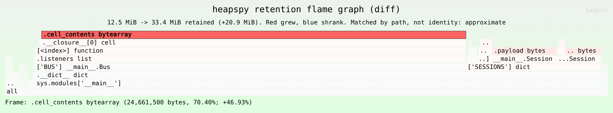

# heapspy

Read the object graph of a running Python process from the outside, and find out what is keeping memory alive.

py-spy reads a process's stacks without touching it. heapspy does the same for the heap: it takes a consistent memory image of a CPython process, rebuilds the object graph from it, and computes dominators and retained sizes. Nothing is injected or imported into the target.

> **Status: early development.** `heapspy dump` (`--pid`, `--core`, `--minidump`) walks CPython 3.12, 3.13 and 3.14 heaps (default GIL builds, 64-bit) into snapshots, and `analyze`, `query`, `diff` and `flamegraph` work on them. Free-threaded and debug builds are refused. The walker's per-version layouts are in [docs/cpython-internals.md](docs/cpython-internals.md). An end-to-end suite ([tests/e2e](tests/e2e/README.md)) checks on Linux that known leaks in real 3.12 to 3.14 processes are found, by `--pid` and from `gcore` cores. The MCP server is in [python/heapspy-mcp](python/heapspy-mcp/README.md). Nothing is published on PyPI yet, and the Windows code paths have only been compile-checked, not run on Windows.

## What it answers, and what it doesn't

heapspy answers **"what is retained, and by whom?"** For a leak, that is usually the question that matters: the reference holding the memory is the thing you delete to fix it, and that reference is sitting in the heap right now. Eclipse MAT finds JVM leaks the same way, from heap dumps with no allocation stacks.

heapspy cannot answer **"where was this allocated?"** for memory that already exists. That history is only recorded if a tracer was running at allocation time. A planned `heapspy record` command (M7) will sample allocations with their Python stacks from outside the process, for a bounded window. It uses eBPF on Linux, and ETW plus debugger breakpoints on Windows, and only sees allocations made while it runs. See [docs/allocation-sampling.md](docs/allocation-sampling.md). For full allocation history from process start, use tracemalloc or memray. For CPU, use py-spy alongside heapspy.

## How it works

```
target Python process        untouched, no agent
        |
        |  heapspy dump        privileged, read-only
        v                      Linux: gcore / process_vm_readv
snapshot.hpy                   Windows: full minidump / ReadProcessMemory
        |
        |  heapspy analyze / query / diff     unprivileged, file only
        v
dominator tree, retained sizes, type histogram, retaining paths, diffs
```

`dump` is the only step that touches the target and the only step that needs privileges. It locates `PyRuntime` in libpython (or `python3xx.dll`), walks the GC generation lists to find every tracked container, follows each object's references the way its `tp_traverse` would, and writes a compact binary snapshot.

Everything else reads the snapshot file. You can re-analyze without re-dumping, attach a snapshot to a bug report, or diff two captures taken an hour apart.

## Planned usage

### Capture a snapshot

```sh
# Dump a live process (brief pause while the image is taken)
heapspy dump --pid 1234 -o app.hpy

# Or convert an image you already have
heapspy dump --core core.1234 -o app.hpy      # Linux ELF core
heapspy dump --minidump app.dmp -o app.hpy    # Windows full minidump
```

By default the snapshot records types, sizes, lengths, and references, but **not** string or bytes contents. Contents often hold tokens, credentials, and user data. To include them, opt in explicitly; values are size-capped and redacted:

```sh
heapspy dump --pid 1234 --capture-contents --max-str 128 -o app.hpy
```

### Find what retains memory

```sh
heapspy analyze app.hpy
```

Example output (illustrative):

```
Top retainers by retained size

  retained   shallow   type                  root path
  412.6 MiB  36.9 MiB  builtins.dict         sys.modules['app.cache'].__dict__['CACHE']
   18.2 MiB   1.1 KiB  app.events.Registry   sys.modules['app.events'].__dict__['REGISTRY']
    4.0 MiB  12.0 KiB  builtins.list         frame worker:run -> local 'pending'

Python graph accounts for 448 MiB of 1.9 GiB RSS. The rest is outside the
object graph (native allocations, C extensions, untracked objects).
```

### Drill into a type or object

```sh
# All instances of a type, with sample holders
heapspy query app.hpy --type app.session.Session

# The labelled chain of references keeping one object alive
heapspy query app.hpy --retaining-path 0x7f3a2c41b0d0
```

A retaining path reads root-first, one labelled hop per line:

```
sys.modules['app.cache']
  .__dict__['CACHE']            builtins.dict
  ['user:8812']                 app.session.Session
  .payload                      builtins.bytes  (1.0 MiB)
```

### Compare two captures

```sh
heapspy dump --pid 1234 -o before.hpy
# ... let the process run ...
heapspy dump --pid 1234 -o after.hpy

heapspy diff before.hpy after.hpy
```

`diff` reports growth by type and by retaining site. Object addresses change between dumps, so matching individual objects across snapshots is approximate. The output says so and reports aggregates.

### Retention flame graph

```sh
heapspy flamegraph app.hpy -o app.svg
```



A retention flame graph shows the dominator tree. A snapshot has no call stacks, so a frame is not a function. Each frame is one hop of a retaining path, and its width is the bytes it retains: the objects in that frame and everything only reachable through them. The bottom row holds the roots (`sys.modules['__main__']`, frame locals, thread state). Each row above it names the reference that holds the next object. To find a leak, look for the widest frame you did not expect and read down to its root. In the image above, `.cell_contents bytearray` under `BUS.listeners` holds 70% of the heap: closures registered as listeners keep their buffers alive. `['SESSIONS'] dict` holds most of the rest.

A CPU flame graph is different. Its widths count samples of time, and its frames are call stacks. An allocation flame graph (memray, tracemalloc, or `heapspy flamegraph --allocations` below) counts bytes allocated by each call stack, including memory freed long ago. A retention flame graph counts only memory that is alive in the snapshot, grouped by what keeps it alive, not by where it was allocated.

Frame format:

| object | frame text | example |
|---|---|---|
| root object | its root label | `sys.modules['__main__']` |
| other object | label of the edge into it, a space, its type (`builtins.` dropped) | `['SESSIONS'] dict`, `.listeners list`, `.__closure__[0] cell`, `.cell_contents bytearray` |
| reached through objects its dominator owns | `...` before the edge label | `...[<index>] bytes` |
| dominated only by the super-root, not a root itself (shared by several roots) | a top-level frame with `...` | `...['SHARED'] list` |
| folded objects | `[other]` | |

The edge is the one breadth-first search entered the object through, as for `diff` sites ([docs/json-schema.md](docs/json-schema.md)). A `;` inside a label is written as `:`.

Merge rules: siblings with the same frame text become one frame. List and tuple indices are written `[<index>]`, so all items of a list merge. Without `--capture-contents`, dict keys are placeholders such as `[<str len=9>]`, so all values whose keys have the same type and length merge. Merged frames merge their children too, so a cache of 100,000 sessions is one wide `['CACHE'] dict` frame with one `[<str len=N>] Session` frame per key length above it. A frame's self bytes are the shallow sizes of the objects merged into it, and its width (self plus everything above it) equals their total retained size.

Cutoffs keep the output small on large heaps. Objects more than `--max-depth` levels (default 32) below a root are counted in an `[other]` frame at that depth. A frame narrower than `--min-pct` percent of the reachable bytes (default 0.01) or `--min-bytes N` is folded, with everything above it, into an `[other]` frame beside it. Folding never changes the width of the frames that remain.

```sh
# Folded stacks (`frame;frame;frame bytes`) for other tools, on stdout
heapspy flamegraph app.hpy --folded --min-bytes 0 > app.folded

# Differential: red frames grew, blue frames shrank, width is AFTER
heapspy flamegraph --diff before.hpy after.hpy -o diff.svg
```



The differential graph matches frames between the two dumps by frame text, not by object identity, so the matching is approximate in the same way as `diff`. For example, sessions whose keys got one character longer show up as a new frame. `--diff ... --folded` writes `stack before after` lines, the input format of inferno's and FlameGraph's differential mode. The cutoff applies to the wider of the two sides, so a frame is folded in both snapshots or in neither.

### Record where memory is allocated (M7, in progress)

```sh
# Sample allocations with their Python stacks for 60 s, then take a snapshot
heapspy record --pid 1234 --duration 60s -o app.hpya --then-dump app.hpy

heapspy analyze app.hpy --allocations app.hpya
heapspy query app.hpy --type Session --allocations app.hpya
```

`record` takes `--events arena,pool,large`, `--interval BYTES` (mean bytes between large-object samples, default 512K), `--max-frames N` (default 64) and `--mechanism auto|ebpf|ptrace|etw|debugger`. The `.hpya` file format is final for version 1. The recorders are not implemented yet: `record` exits with a "not implemented yet" error (with `--json`, an error document with code `unimplemented`; a PID with no process gives `no_such_process`). The analyzer side works on any `.hpya` file.

`analyze --allocations` links snapshot objects to samples by address. Each object gets the latest sample whose range (an arena, a pool, or one large allocation) contains it. It then adds an "Allocated by" section: the stacks that allocated the most during the window, innermost frame first with `file:line`, with estimated bytes allocated and the bytes of live objects linked to each. Under each top retainer it shows the one or two stacks that allocated the memory it retains. `query --type --allocations` shows the same per instance. Read the numbers as an estimate of where growth came from:

- Only allocations made while recording are covered. Memory allocated before recording started, and blocks reused from freed memory, have no stack.
- Links through large-object samples are exact. Links through arena and pool samples are approximate: they name the most recent growth event that created the memory, not necessarily the call that allocated the object. The text output marks each stack `exact` or `approx`.
- If the profile is from another pid or CPython version, or recording started after the snapshot, heapspy warns and links nothing.

`diff --allocations` only checks the profile against AFTER for now; it does not add stacks to growth sites. The JSON fields are `allocations` and `allocated_at` ([docs/json-schema.md](docs/json-schema.md#allocations)), and the join is described in [docs/allocation-sampling.md](docs/allocation-sampling.md#joining-with-a-snapshot).

### Allocation flame graph

```sh
# Width is estimated bytes allocated while recording
heapspy flamegraph --allocations app.hpya -o alloc.svg

# Width is the bytes still alive in the snapshot, by allocating stack
heapspy flamegraph --allocations app.hpya --retained app.hpy -o alive.svg

heapspy flamegraph --allocations app.hpya --folded > alloc.folded
```

This is a classic flame graph of the sampled stacks. Frames are Python functions written `function (file:line)`, the outermost frame is at the root, and width is bytes. Without `--retained`, the width is the estimated bytes allocated, which includes memory freed since. With `--retained SNAP`, the width is the bytes of the objects in the snapshot linked to each stack's samples, which shows where the memory still alive was allocated. The subtitle gives the recording length, the sample count, the mechanisms, and whether any frames were matched by time (approximate). `--min-bytes` and `--min-pct` fold narrow frames into `[other]` as for retention graphs. `--max-depth` does not apply.

### JSON output

Every command except `flamegraph` takes `--json`. The schema is versioned and kept stable, since tooling (including the MCP server below) builds on it. `dump --json` reports what was written; a failed command prints an error document with a stable code such as `not_python` or `permission_denied`. See [docs/json-schema.md](docs/json-schema.md).

```sh
heapspy analyze app.hpy --json | jq '.top_retainers[0]'
heapspy dump --pid 1234 -o app.hpy --json | jq '.objects, .pause_ms'
```

## Permissions

Dumping another process needs elevated rights. Analysis does not.

| OS      | `dump` needs                                                                 |
|---------|------------------------------------------------------------------------------|
| Linux   | `CAP_SYS_PTRACE`, or a permissive `kernel.yama.ptrace_scope`. In containers: `SYS_PTRACE` and a shared PID namespace. |
| Windows | `SeDebugPrivilege` (run elevated) to read another user's process.            |

Taking the image pauses the target. On a large heap, expect a pause of a few seconds and a multi-gigabyte image file.

## Supported targets (v1)

| | v1 | Later |
|---|---|---|
| OS | Linux, Windows | macOS |
| CPython | 3.12, 3.13, 3.14 | free-threaded builds |
| Acquisition | consistent dump (ELF core, full minidump) | live attach with a brief stop |
| Graph | GC-tracked containers and the leaf objects they reference | full pymalloc arena walk |
| Native memory | totals only, from memory maps | per-allocation detail |

Out of scope for v1: allocation call chains, per-object native or C-extension memory, leaks made only of untracked objects, reads with no pause, and runtimes other than CPython.

## Known blind spots

- **Untracked objects.** Bare ints, short strings, and raw buffers are not on the GC lists. heapspy sees them only when a tracked container references them. A leak made entirely of floating untracked objects will not show up in v1, and the output will say so.
- **Native memory.** Memory allocated by C extensions is invisible to the object graph. heapspy reports how much of RSS falls outside the graph rather than guessing.
- **Struct layouts.** CPython's internal layouts change between versions and builds. heapspy uses DWARF or PDB symbols when available, 3.14's debug offsets section where present, and shipped per-version offset tables otherwise.

## Agent integration: heapspy-mcp

A second package, `heapspy-mcp` in [`python/heapspy-mcp`](python/heapspy-mcp/README.md), exposes heapspy to coding agents over the Model Context Protocol. It shells out to the `heapspy` binary and parses `--json`. The intended loop: capture a snapshot, summarize it, pick a suspect, trace what retains it, map the holder to `file:line` in your repo, read the code, diagnose. It is built and tested against the documented JSON schema; it becomes useful once `dump` and the analyzer work.

Tools:

| Tool | Purpose |
|---|---|
| `list_python_processes` | candidate PIDs with RSS, command line, Python version |
| `capture_snapshot` | dump a PID or ingest a core/minidump (privileged, requires confirmation) |
| `heap_summary` | top retainers and type histogram |
| `retaining_path` | the chain keeping an object or type alive |
| `type_detail` | instances, sizes, sample holders for one type |
| `diff_snapshots` | growth between two captures |
| `map_to_source` | resolve `module.qualname` to `file:line` |

`capture_snapshot` is the only tool that touches a process, and it is gated by confirmation, a process allowlist, and a heap-size limit. The other tools only read snapshot files. Tools return bounded, ranked summaries. The raw graph is never sent to the model, both to keep token use down and to keep memory contents out of transcripts.

## Installation (planned)

Nothing has been released yet. Until the first release, the commands below will not find a package. heapspy will be a Rust binary distributed as PyPI wheels, the same way py-spy is. The wheels contain only the binary and work with any Python 3.8 or later:

```sh
pip install heapspy
pipx install heapspy      # or keep it in its own environment
pip install heapspy-mcp   # optional, for agent integration
```

Wheels are planned for Linux x86_64 and aarch64 (glibc), Linux x86_64 (musl) and Windows x86_64. Each GitHub release will also have the bare binaries attached.

To build from source now, with Rust 1.85 or later:

```sh
cargo install --git https://github.com/Heknon/heapspy heapspy
```

See [docs/releasing.md](docs/releasing.md) for how releases are built and published.

## Roadmap

| Milestone | Deliverable | Status |
|---|---|---|
| M1 | Linux core dump reader to snapshot, proven on one `gcore` of a 3.12 process | done |
| M2 | Analyzer: dominators, retained sizes, histogram, retaining paths, `--json`, property tests | done |
| M3 | Linux end-to-end test matrix (3.12 to 3.14) passing in CI | passes locally; CI job added (`ci:e2e`), not yet run on GitHub |
| M4 | Windows minidump backend | done |
| M5 | Windows end-to-end test matrix passing on `windows-latest` | harness and CI job written, not yet run |
| M6 | `heapspy-mcp` | done |
| M7 | `heapspy record`: sampled allocation stacks from outside the process (Linux eBPF, Windows ETW and debugger breakpoints), joined with snapshots. Design in [docs/allocation-sampling.md](docs/allocation-sampling.md) | designed; not implemented |

The end-to-end tests run heapspy against fixture processes with known leaks (an unbounded module-level cache, a listener registry that never shrinks, a closure holding a large object, and others) and check that the analyzer names the right holder, reports a retained size within tolerance, and produces the expected retaining path. See [tests/e2e/README.md](tests/e2e/README.md).

## Repository layout

| Path | Contents |
|---|---|
| `crates/heapspy-snapshot` | snapshot file format: types, streaming writer, mmap reader, test builder |
| `crates/heapspy-reader` | `MemorySource` trait, ELF core / live Linux / minidump backends, CPython walker, `dump` |
| `crates/heapspy-analyzer` | JSON report types (schema v1), dominators, retained sizes, paths, diffs |
| `crates/heapspy-alloc` | allocation profile format (`.hpya`): types, streaming writer, mmap reader, line tables, test builder |
| `crates/heapspy-record` | `heapspy record`: recorder interface and options; eBPF, ptrace and Windows recorders (stubs) |
| `crates/heapspy` | the `heapspy` command-line tool |
| `tests/e2e` | end-to-end tests against real CPython processes (pytest) |
| `docs/snapshot-format.md` | byte-level specification of `.hpy` files |
| `docs/alloc-format.md` | byte-level specification of `.hpya` files |
| `docs/allocation-sampling.md` | M7 design: allocation sampling from outside the process |
| `docs/json-schema.md` | the `--json` output schema; examples in `docs/examples/` |
| `python/heapspy-mcp` | the `heapspy-mcp` MCP server (Python) |
| `docs/releasing.md` | how to cut a release and the one-time PyPI setup |
| `pyproject.toml` | maturin config that packages the `heapspy` binary as a PyPI wheel |
| `scripts/check-version.py` | checks that the release tag and package versions agree |

See [CONTRIBUTING.md](CONTRIBUTING.md) for the local checks and how CI is run.

## License

MIT. See [LICENSE](LICENSE).
