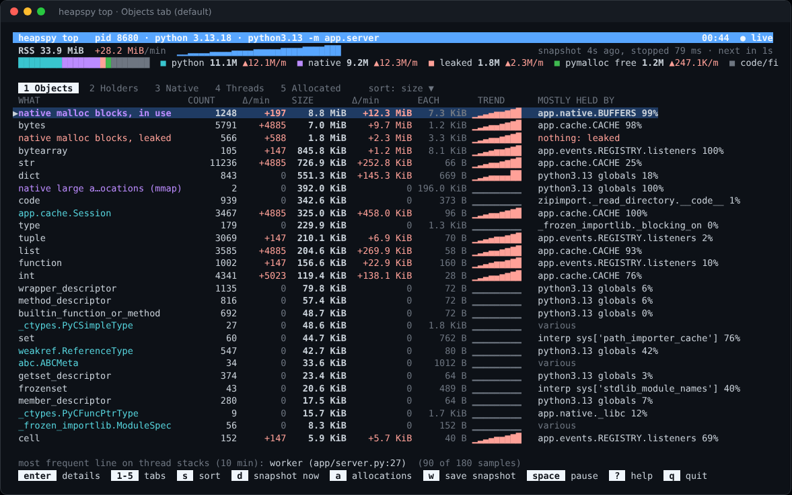

# heapspy

See what is using memory in a running Python process, and what keeps it alive.

heapspy reads a CPython process from the outside, the way py-spy reads its
stacks: nothing is injected or imported into the target. It rebuilds the
object graph, walks the native (malloc) heap, and tells you which objects
take the memory, who holds them, and what is growing.



## Install

```sh
pip install heapspy        # or: pipx install heapspy
```

The wheels hold only the binary and work with any Python 3.8 or later. They
are built for Linux x86_64 and aarch64 (glibc), Linux x86_64 (musl) and
Windows x86_64; each [GitHub release](https://github.com/Heknon/heapspy/releases)
also has the bare binaries. To build from source (Rust 1.85 or later):

```sh
cargo install --git https://github.com/Heknon/heapspy heapspy
```

## Quick start

```sh
sudo heapspy top --pid 1234                 # live view; Enter on a row for details
sudo heapspy analyze --pid 1234             # one report, right now
sudo heapspy watch --pid 1234 --every 30s   # what grows, and how steadily
sudo heapspy watch --pid 1234 --counters    # live counters, never pausing the process
sudo heapspy agent --server http://pyroscope:4040 --discover myapp   # continuous profiles
```

- **`top`** is a live, full-screen view. Its main table lists what the
  memory is made of, with count, size, growth per minute and the holder
  that keeps most of it. Other tabs list holders, native memory, threads
  and, after you press `a`, the code that allocated what is still alive.
- **`analyze --pid`** prints the same as one report, plus what each thread
  was running.
- **`watch`** takes a snapshot every interval and prints one line per round.
  On Ctrl-C it prints each holder's growth with a verdict: likely leak, keep
  watching, or fine.
- **`watch --counters`** takes no snapshot: it reads CPython's GC and
  allocator counters and glibc's heap sizes while the process runs, in about
  a millisecond, so it can sample every second or faster. With `--json` it
  is a stream for your own graphs; `top` draws the same numbers in its
  Graphs tab.
- **`agent`** runs continuously and sends memory profiles to
  [Pyroscope](https://grafana.com/oss/pyroscope/) or Grafana Cloud: where
  the memory is (never pausing the process), and, when asked, who holds it
  and what allocated it. See [docs/cli.md](docs/cli.md#agent).

Reading another process needs ptrace rights on Linux and an elevated prompt
on Windows; reading snapshot files needs nothing.

## Reading the report

```
Memory 65.0 MiB resident
  · Python objects 25.7 MiB 39%   · Native, in use 23.9 MiB 37%   · Native, leaked 4.6 MiB 7%

What the memory is                mostly held by              count       size     each  keeps alive
  native malloc blocks, in use     98% app.native.BUFFERS      1483   23.5 MiB 16.2 KiB     23.5 MiB
  bytes                            99% app.cache.CACHE        11664   18.7 MiB  1.6 KiB     18.7 MiB
  native malloc blocks, leaked    nothing: leaked              1272    4.6 MiB  3.7 KiB      4.6 MiB
  bytearray                       100% …EGISTRY.listeners       282    2.2 MiB  8.1 KiB      2.2 MiB
  interpreter internals           the interpreter itself       1120  964.5 KiB    881 B    964.5 KiB
  app.cache.Session               100% app.cache.CACHE         9340  875.6 KiB     96 B     20.1 MiB

Who holds it                                                    retained    python    native   share
 1  app.native.BUFFERS                                          23.5 MiB  14.9 KiB  23.4 MiB   47.3%
      list · 751 objects · holds native malloc blocks, in use 23.5 MiB
 2  app.cache.CACHE                                             20.8 MiB  20.8 MiB         0   42.0%
      dict · 46534 objects · holds bytes 18.7 MiB, str 1.0 MiB, app.cache.Session 875.6 KiB
```

- **What the memory is**: one row per type, by the bytes its objects take.
  Native malloc blocks are rows too, split into blocks something points to
  and blocks nothing points to (leaked: their address is gone, so nothing
  can free them). Next to each row is the holder that keeps most of it alive.
- **Who holds it**: the objects that keep the most memory alive. Retained
  bytes are what would be freed if the holder went away, split into Python
  objects and native memory. Holders are named the way code names them:
  `app.cache.CACHE`, or `libfoo.so: g_cache` for a C global.
- **The memory bar**: where the memory sits. Python objects, native memory
  in use, leaked native blocks, free memory malloc keeps, and code, mapped
  files and stacks.

To see why one kind of object is alive, ask about its type:

```
$ heapspy query app.hpy --type bytes
Kept alive by
  share  kept by            instances      bytes  sizes
    89%  app.cache.CACHE          660    1.3 MiB  2081 B ×660
        through [<key>] app.cache.Session → .payload
```

[docs/cli.md](docs/cli.md#reading-the-reports) explains every row and
column, and what to do when each one is large.

## Snapshots

A snapshot is a file holding the object graph, the native heap blocks and
the memory map. Every command can read one, on any machine, without
privileges.

```sh
sudo heapspy dump --pid 1234 -o app.hpy        # a live process
heapspy dump --core core.1234 -o app.hpy       # a Linux core
heapspy dump --minidump app.dmp -o app.hpy     # a Windows full minidump

heapspy analyze app.hpy                        # the report above
heapspy query app.hpy --type Session           # what keeps one type alive
heapspy query app.hpy --retaining-path 0x7f3a2c41b0d0
heapspy diff before.hpy after.hpy              # what grew between two snapshots
heapspy flamegraph app.hpy -o app.svg          # retention flame graph
```

Taking a snapshot stops the process for the walk: about 0.1 s for a small
heap, seconds for millions of objects. The pause is printed. `--no-stop`
walks it while it runs, for an approximate snapshot (Linux).

Snapshots record types, sizes and references, not string or bytes contents,
which often hold tokens and user data. `--capture-contents` records them,
capped by `--max-str`.

## Where memory was allocated

A snapshot shows what is alive and who holds it, not which code allocated
it. For that, record allocations for a while and join them with a snapshot:

```sh
sudo heapspy record --pid 1234 --duration 60s -o app.hpya --then-dump app.hpy
heapspy analyze app.hpy --allocations app.hpya
```

`record` samples allocations with their Python stacks from outside the
process: eBPF on Linux, ETW on Windows. It sees only allocations made while
it runs. `top --alloc` does the same from the live view. The mechanisms and
their cost are in [docs/cli.md](docs/cli.md#record). For full allocation
history from process start, use tracemalloc or memray.

## How it works

`dump` finds `_PyRuntime` in libpython, walks the garbage collector's lists
to find every tracked container, and follows each object's references the
way its `tp_traverse` would. It then walks glibc's malloc heap (or the
Windows heap from a minidump) and scans native blocks, C globals and thread
stacks for pointers, so native memory gets owners too. The analyzer builds
the dominator tree over all of it: an object's retained size is everything
only it keeps alive.

`top` and `watch` repeat this on a schedule. `top` also reads memory totals
from the OS and each thread's Python stack every second, without stopping
the process.

## Supported targets

| | |
|---|---|
| OS | Linux (x86_64, aarch64), Windows (x86_64) |
| CPython | 3.12, 3.13, 3.14, 64-bit, default builds. Free-threaded and debug builds are refused. |
| Native heap walk | glibc malloc 2.15 to 2.43; the Windows heap from minidumps. With other allocators (jemalloc, tcmalloc, mimalloc) native memory is one total. |
| Linux permissions | `CAP_SYS_PTRACE` or a permissive `kernel.yama.ptrace_scope`; in containers, `SYS_PTRACE` and a shared PID namespace. `record` and `top --alloc` need root or `CAP_BPF` + `CAP_PERFMON`. |
| Windows permissions | an elevated prompt to read another user's process |

## Limits

- **Untracked objects.** Bare ints, short strings and raw buffers are not on
  the garbage collector's lists. heapspy sees them only when a tracked
  container references them, so a leak made only of such objects does not
  show up.
- **C structs heapspy has no layout for** (extension types). Their fields
  are scanned for pointers and checked against reference counts. A pointer
  into native memory reads as `C field +offset`, not the field's name.
- **Native ownership.** A native block's owner is whatever points to it.
  A snapshot cannot say who allocated it; `record` can, for allocations made
  while it runs (native heap events on Windows only for now).
- **Layouts.** CPython's internal layouts change between versions. heapspy
  uses `_Py_DebugOffsets` on 3.13 and later, DWARF or PDB symbols when
  present, and shipped per-version tables otherwise.

## For tools and agents

Every command except `top` and `flamegraph` takes `--json`. The schema is
versioned and stable within a version: fields are only added
([docs/json-schema.md](docs/json-schema.md)). Errors are JSON documents too,
with codes such as `permission_denied` or `not_python`.

[heapspy-mcp](python/heapspy-mcp/README.md) (`pip install heapspy-mcp`)
exposes heapspy to coding agents over the Model Context Protocol: find the
process, take a snapshot with the user's consent, summarize it, follow a
holder to `file:line`. It also has process and CPU diagnostics. The raw
object graph is never sent to the model.

## Documentation

| | |
|---|---|
| [docs/cli.md](docs/cli.md) | every command, its output, and what it costs the process |
| [docs/flamegraph.md](docs/flamegraph.md) | reading retention and allocation flame graphs |
| [docs/allocation-sampling.md](docs/allocation-sampling.md) | how `record` samples allocations from outside |
| [docs/json-schema.md](docs/json-schema.md) | the `--json` schema, with examples in `docs/examples/` |
| [docs/cpython-internals.md](docs/cpython-internals.md) | the CPython layouts the walker relies on |
| [docs/snapshot-format.md](docs/snapshot-format.md), [docs/alloc-format.md](docs/alloc-format.md) | the `.hpy` and `.hpya` file formats |
| [docs/windows.md](docs/windows.md) | Windows specifics |
| [scripts/investigate.py](scripts/investigate.py) | runs `dump`, `analyze` and `diff` in rounds until it can say which holder leaks and where its code is |
| [CONTRIBUTING.md](CONTRIBUTING.md) | local checks, CI labels, end-to-end tests |
| [docs/releasing.md](docs/releasing.md) | how releases are cut |

## License

MIT. See [LICENSE](LICENSE).
