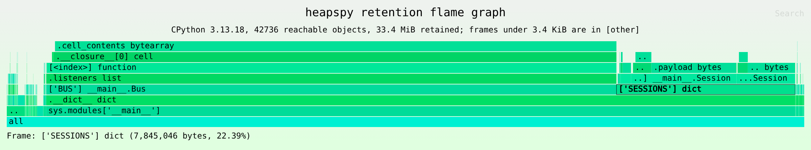
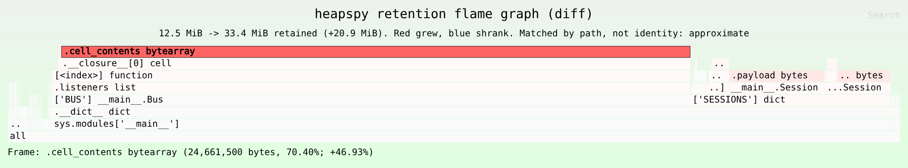

# Flame graphs

`heapspy flamegraph` draws two kinds of flame graph: a **retention** flame
graph of a snapshot (what keeps memory alive), and an **allocation** flame
graph of a profile from `heapspy record` (which code allocated it). Both are
SVG files, or folded stacks with `--folded`.

## Retention flame graph

```sh
heapspy flamegraph app.hpy -o app.svg
```



A retention flame graph shows the dominator tree. A snapshot has no call stacks, so a frame is not a function. Each frame is one hop of a retaining path, and its width is the bytes it retains: the objects in that frame and everything only reachable through them. The bottom row holds the roots (`sys.modules['__main__']`, frame locals, thread state). Each row above it names the reference that holds the next object. To find a leak, look for the widest frame you did not expect and read down to its root. In the image above, `.cell_contents bytearray` under `BUS.listeners` holds 70% of the heap: closures registered as listeners keep their buffers alive. `['SESSIONS'] dict` holds most of the rest.

A CPU flame graph is different. Its widths count samples of time, and its frames are call stacks. An allocation flame graph (memray, tracemalloc, or `heapspy flamegraph --allocations`, below) counts bytes allocated by each call stack, including memory freed long ago. A retention flame graph counts only memory that is alive in the snapshot, grouped by what keeps it alive, not by where it was allocated.

Frame format:

| object | frame text | example |
|---|---|---|
| root object | its root label | `sys.modules['__main__']` |
| other object | label of the edge into it, a space, its type (`builtins.` dropped) | `['SESSIONS'] dict`, `.listeners list`, `.__closure__[0] cell`, `.cell_contents bytearray` |
| reached through objects its dominator owns | `...` before the edge label | `...[<index>] bytes` |
| dominated only by the super-root, not a root itself (shared by several roots) | a top-level frame with `...` | `...['SHARED'] list` |
| folded objects | `[other]` | |

The edge is the one breadth-first search entered the object through, as for `diff` sites ([json-schema.md](json-schema.md)). A `;` inside a label is written as `:`.

Merge rules: siblings with the same frame text become one frame. List and tuple indices are written `[<index>]`, so all items of a list merge. Without `--capture-contents`, dict keys are placeholders such as `[<str len=9>]`, so all values whose keys have the same type and length merge. Merged frames merge their children too, so a cache of 100,000 sessions is one wide `['CACHE'] dict` frame with one `[<str len=N>] Session` frame per key length above it. A frame's self bytes are the shallow sizes of the objects merged into it, and its width (self plus everything above it) equals their total retained size.

Cutoffs keep the output small on large heaps. Objects more than `--max-depth` levels (default 32) below a root are counted in an `[other]` frame at that depth. A frame narrower than `--min-pct` percent of the reachable bytes (default 0.01) or `--min-bytes N` is folded, with everything above it, into an `[other]` frame beside it. Folding never changes the width of the frames that remain.

```sh
# Folded stacks (`frame;frame;frame bytes`) for other tools, on stdout
heapspy flamegraph app.hpy --folded --min-bytes 0 > app.folded

# Differential: red frames grew, blue frames shrank, width is AFTER
heapspy flamegraph --diff before.hpy after.hpy -o diff.svg
```



The differential graph matches frames between the two dumps by frame text, not by object identity, so the matching is approximate in the same way as `diff`. For example, sessions whose keys got one character longer show up as a new frame. `--diff ... --folded` writes `stack before after` lines, the input format of inferno's and FlameGraph's differential mode. The cutoff applies to the wider of the two sides, so a frame is folded in both snapshots or in neither.

## Allocation flame graph

```sh
# Width is estimated bytes allocated while recording
heapspy flamegraph --allocations app.hpya -o alloc.svg

# Width is the bytes still alive in the snapshot, by allocating stack
heapspy flamegraph --allocations app.hpya --retained app.hpy -o alive.svg

heapspy flamegraph --allocations app.hpya --folded > alloc.folded
```

This is a classic flame graph of the sampled stacks. Frames are Python functions written `function (file:line)`, the outermost frame is at the root, and width is bytes. Without `--retained`, the width is the estimated bytes allocated, which includes memory freed since. With `--retained SNAP`, the width is the bytes of the objects in the snapshot linked to each stack's samples, which shows where the memory still alive was allocated. The subtitle gives the recording length, the sample count, the mechanisms, and whether any frames were matched by time (approximate). `--min-bytes` and `--min-pct` fold narrow frames into `[other]` as for retention graphs. `--max-depth` does not apply.
